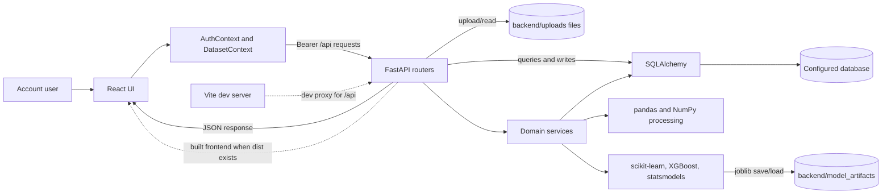
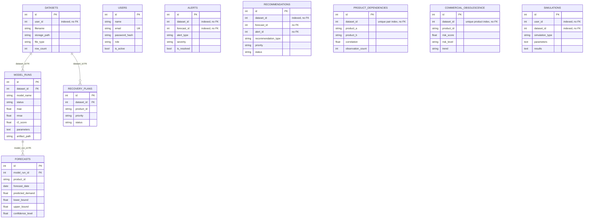
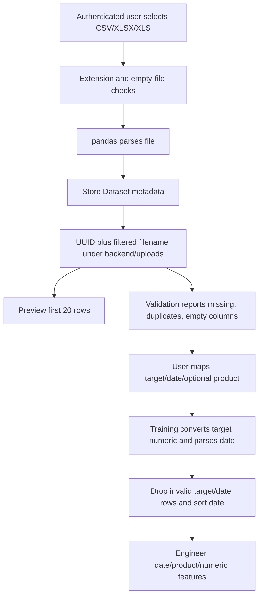
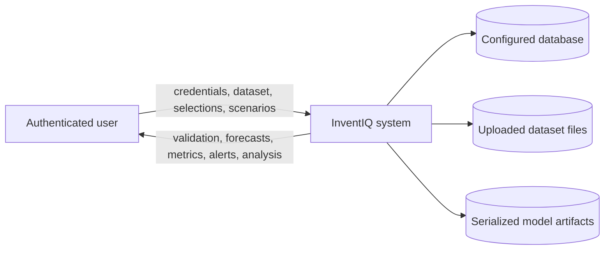
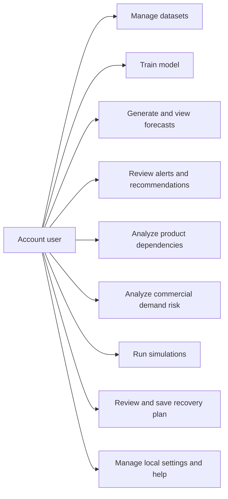
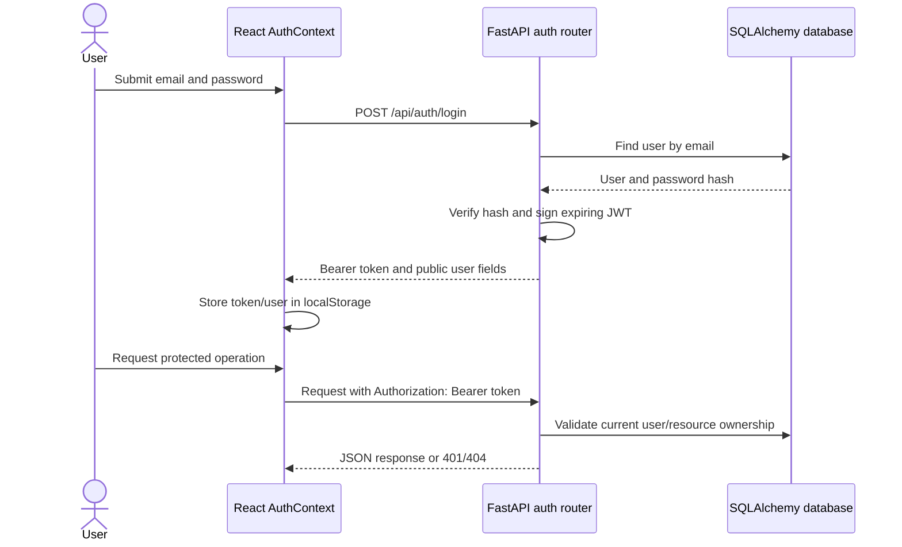
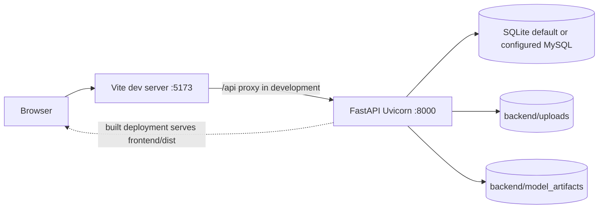

# InventIQ Project Report Reference

## Audit Record

- **Project name supplied for the report:** InventIQ - AI-Powered Demand Forecasting and Inventory Intelligence System.
- **Audit date:** 2026-10-09.
- **Project root inspected:** `C:\Users\maheesha\Downloads\inventory 2\zip file`.
- **Active application roots:** `frontend/` and `backend/`. `backup_before_simplification/` was treated as a historical copy, not as the active implementation.
- **Files/modules inspected:** frontend application entry, app shell, page host, contexts, active pages and components, settings utilities, Vite/Tailwind/package configuration; backend entry/config/database/auth, all active routers, services, SQLAlchemy models, Pydantic schemas, dependency manifests, READMEs, tests; uploaded CSV header lines; upload and model-artifact directory listings.
- **Verification performed:** source inspection; read-only inspection of CSV headers only; backend unittest task; frontend production build task.
- **Important audit limits:** the active database was not queried for records, table counts, migration state, or current user/dataset/model-run data. CSV body values, row counts, inferred dtypes, date ranges, missing-value rates, and duplicate counts were not inspected. No credentials or `.env` values were read. No authenticated browser session was available for inspecting protected screens. No user, upload, forecast, model run, or other database record was created or changed.

## Evidence Status

Use these labels throughout the report:

- **Implemented, source-verified:** corresponding active code exists and its behavior was inspected. This does not imply production or integration testing.
- **Test-verified:** a named automated test or build ran successfully during this audit. The scope is limited to that test/build.
- **Partially implemented:** code exists, but operation is conditional on data or has a documented limitation/incomplete behavior.
- **Not verified:** the source may support the behavior, but the relevant runtime, data, external service, or protected UI could not be inspected.
- **Not implemented in active source:** no active route/service/UI implementation was found. A backup copy, uploaded file, README statement, or requested feature alone is not proof of an active feature.

## 1. Project Overview

### Name and terminology

The active frontend title is `InventIQ - AI Inventory Intelligence & Demand Forecasting` (`frontend/index.html`). The backend FastAPI description includes `Demand Forecasting and Zero Waste Inventory` (`backend/app/main.py`). The backend README calls it an inventory intelligence platform. The longer title at the top of this document is supplied by the project owner; it is not a title string found verbatim in the source.

### Problem framing

No formal problem statement or motivation document was found in the active project files. The following is an **implementation-derived framing**, not a verified institutional problem statement: users can upload historical product data, train regression or time-series models, project future demand, and review demand/stock-related indicators in one application. The code does not establish the project's external motivation, local business requirements, or measured impact.

### Aim and objectives supported by the implementation

The implemented aim can be described as providing a browser-based workflow for:

1. Managing CSV and Excel datasets.
2. Mapping a demand target, date field, and optional product field.
3. Training supported models and storing evaluation output and a serialized artifact.
4. Generating date/product forecast rows with intervals where supported.
5. Reviewing historical demand relationships, demand-risk signals, recommendations, simulations, and recovery-planning output.
6. Persisting user-scoped datasets and analysis records in a SQLAlchemy-backed database.

These objectives are inferred from active source. There is no quantified service-level target, cost-reduction target, or demonstrated business-outcome measure in the inspected files.

### Scope and users

The UI and API support authenticated accounts, dataset selection, model configuration, forecast generation, and inventory-intelligence workflows. The app stores a `role` on user records but the inspected API does not implement role-based permissions; data access is primarily scoped to the authenticated user. Inventory planners, analysts, and operations staff are plausible users from the screen labels, but explicit user personas or interview evidence are unavailable.

### Implemented features

- Registration, login, bearer-token auth, account lookup, and client-side logout.
- CSV/XLSX/XLS upload, per-user listing, metadata, first-20-row preview, validation, column roles, demand-history endpoint, and dataset deletion.
- Model configuration, training, model-run listing/details, persisted metrics/parameters, and joblib artifacts.
- Forecast generation, saved rows, summary/history APIs, product selection, a forecast chart suite, and confidence-bound display.
- Alerts and recommendation generation, listing, filtering, resolving/completing.
- Product Dependency Analysis using Pearson correlation and a correlation matrix.
- Commercial demand-weakening analysis and risk-score persistence.
- Demand/supplier-delay/promo scenario records and an inventory-adjustment counterfactual path.
- Demand/stock recovery assessment and saved recovery-plan records.
- Responsive dashboard, settings, help, local notification preferences, and health/system-information endpoints.

### Benefits and limitations

Potential benefits are workflow consolidation and faster review of model-backed demand estimates. These benefits are not measured by the repository. Important limitations include data-dependent inventory calculations, one chronological holdout rather than rolling backtests, no demonstrated interval-coverage calibration, local artifact/file storage, no visible migration history, limited automated test coverage, and unverified deployment hardening. Several UI labels describe scenarios more broadly than the actual calculation; see Sections 8 and 14.

## 2. Technology Stack

| Area | Technology and declared version | Actual role |
|---|---|---|
| Frontend framework | React `^18.3.1`; `react-dom ^18.3.1` | Single-page interface and interactive page components. |
| Language/module format | JavaScript JSX, ES modules | Frontend source. No TypeScript application source was found. |
| Build/dev server | Vite `^5.4.9`; build observed as Vite `5.4.21` | Dev server on port 5173, `/api` proxy, and `frontend/dist` production output. |
| CSS | Tailwind CSS `^3.4.13`, PostCSS `^8.4.47`, Autoprefixer `^10.4.20` | Utility-first styling, responsive layout, light/dark variants. |
| Charts | Recharts `^3.10.1`, plus inline SVG/HTML | Recharts is imported by `ForecastCharts.jsx`; the main Dashboard trend is hand-rendered SVG; dependency analysis includes an HTML correlation matrix. |
| UI components | Local components under `frontend/src/components/ui/` | Buttons, cards, inputs, selects, tables, modals, badges, and page headers. No external component framework is declared. |
| Backend framework | FastAPI `0.141.1`, Uvicorn `0.53.0` | HTTP API and ASGI serving. |
| Backend language | Python; backend README states Python 3.14 | Runtime version was not independently queried during this audit. |
| Validation/schema | Pydantic `2.13.5`, `email-validator 2.3.0` | Request validation and health/model response schema declarations. Most endpoints return plain dictionaries/lists rather than declared response models. |
| ORM/database | SQLAlchemy `2.0.43`; SQLite default; PyMySQL `1.2.3` | ORM models, database sessions, SQLite default connection, optional MySQL driver/configuration. Actual runtime database URL/dialect was not inspected. |
| Data processing | pandas `2.3.3`, NumPy `2.3.3` | CSV/Excel parsing, tabular cleanup, grouping, dates, correlation and numerical calculations. |
| ML/regression | scikit-learn `1.7.2` | Linear Regression, Random Forest, metrics, and temporal feature/validation utilities. |
| Gradient boosting | XGBoost `3.0.2` | `XGBRegressor` candidate, imported inside the model path. |
| Time series | statsmodels `0.14.5` | `statsmodels.tsa.arima.model.ARIMA` implementation. |
| Model serialization | joblib `1.5.2` | Saves and reloads fitted model artifacts in `backend/model_artifacts/`. |
| Authentication | PyJWT `2.10.1`, passlib `1.7.4`, bcrypt `5.0.0` | JWT encoding/decoding, PBKDF2 password hashing, and bcrypt verification compatibility. |
| Upload parsing | `python-multipart 0.0.32`, pandas | FastAPI multipart upload parsing and CSV/Excel readers. Excel engine availability is not declared explicitly in `requirements.txt`; XLS/XLSX parsing was not exercised. |
| Backend configuration | python-dotenv `1.2.3` | Loads `backend/.env` if present. `.env` is ignored by `backend/.gitignore`; values were not read. |
| Tests | Python `unittest`; frontend test imports Node built-in `node:test` | Backend suite was run. Frontend package has no `test` script; the single Node test file was not run in this audit. |
| Migrations | No Alembic dependency or active migration directory found | Schema setup is implemented through SQLAlchemy `create_all` and custom `ensure_*` routines in `db.py`. There is no migration version/head to report. |

### Dependency/configuration observations

- Frontend scripts are `dev`, `build`, `preview`, and `lint`; no `test` script is declared.
- `eslint.config.js` exists, but `eslint` is not declared in the active frontend `package.json` dependencies. A prior lint attempt in this workspace failed because the executable was unavailable; lint was not run as part of this audit.
- The frontend `package-lock.json` is present. The build succeeded with a Vite warning that the minified JS chunk is larger than 500 KB.
- The backend `requirements.txt` pins runtime packages. It does not declare `openpyxl` or `xlrd`, which pandas normally needs for XLSX/XLS readers. Excel parsing is coded but not verified in the installed environment.

## 3. Active Project Structure

```text
backend/
  app/
    main.py                 FastAPI app, route registration, startup setup, static fallback
    auth.py                 password/token helpers and account/dataset authorization
    config.py               env/.env configuration; secrets not reproduced here
    db.py                   SQLAlchemy engine, sessions, startup schema ensure functions
    models/                 ten SQLAlchemy entity definitions
    routers/                auth, dataset, training, forecast, analytics, health APIs
    schemas/                request and response Pydantic types
    services/               file/data preparation, ML, analytics, simulation, recovery
  tests/                    two unittest modules
  uploads/                  local uploaded CSV files; 11 files were listed
  model_artifacts/          nine `model_run_N.joblib` files were listed
  inventiq.db               SQLite-named file exists; its contents/runtime use were not queried
  requirements.txt
  README.md
  .env / .env.example       present by listing; `.env` contents were not read
frontend/
  src/App.jsx               auth gate and page selection
  src/main.jsx              React root
  src/context/              AuthContext and DatasetContext
  src/pages/                active dashboard and intelligence/system screens
  src/components/           dataset, model, forecast, and UI components
  src/utils/                local settings, demo utilities, dataset-selection helper/test
  public/favicon.svg
  vite.config.js, tailwind.config.js, postcss.config.js
  package.json, package-lock.json
  dist/                     generated frontend build output
backup_before_simplification/
  historical project copy; not imported by active `frontend/src/App.jsx` or `backend/app/main.py`
```

### Frontend boundaries

- `App.jsx` wraps `AuthProvider` and `DatasetProvider`, then returns Login/Register until authenticated.
- The authenticated app renders `MainLayout` and the `Dashboard` page host. `Dashboard.jsx` uses persistent page slots for the sidebar's screens; it is not a React Router route tree.
- `AuthContext.jsx` stores the token/user in browser local storage and adds bearer authorization to `apiFetch` calls.
- `DatasetContext.jsx` loads the account's datasets and stores a globally selected dataset ID in local storage.
- `components/ModelConfiguration.jsx`, `components/ForecastDashboard.jsx`, and `components/ForecastCharts.jsx` implement training/forecast UI. `pages/` holds analytics, alert, recommendation, simulation, recovery, settings, and help screens.

### Backend boundaries

- `main.py` registers routers, configures CORS, calls `Base.metadata.create_all` and selected `ensure_*` routines on startup, and serves `frontend/dist` when built assets exist.
- Routers validate/authenticate request boundaries and call service functions. Services read the stored dataset, calculate results, and persist domain rows through SQLAlchemy.
- `dataset_service.py` reads stored CSV/Excel data and assigns heuristic column roles. `model_service.py` prepares, trains, evaluates, serializes, and forecasts. Other services implement analytics and inventory/recovery calculations.
- There is no separate API-client package; frontend calls are made through `AuthContext.apiFetch` or direct `fetch` for public/system paths.

## 4. System Architecture and Execution Flow

The UI does not send every operation through ML. Examples: validation reads the uploaded file and reports quality; a dependency matrix can be calculated from source data without a forecast; only training/forecast routes load model artifacts.



### Actual execution paths

- **Dataset upload:** browser `multipart/form-data` -> `/api/datasets/upload` -> pandas parse -> `Dataset` metadata row -> file under `backend/uploads/` -> metadata response. The metadata commit occurs before the file write/second commit, so a filesystem failure can leave an incomplete database record.
- **Training:** selected dataset and mapped columns -> `POST /api/model-runs/train` -> `read_dataset` -> `prepare_frame`/feature construction -> candidate model(s) -> chronological validation -> metrics and uncertainty parameters -> joblib artifact -> completed/failed `ModelRun` row.
- **Forecasting:** completed run + horizon -> forecast router checks run/dataset ownership -> read source data and joblib artifact -> future features or product ARIMA -> interval calculation -> insert/update `Forecast` rows -> generate alerts and recommendations -> response to Forecast UI.
- **Dependency analysis:** selected dataset -> identify date/product/demand columns -> aggregate into a date x product demand matrix -> Pearson coefficients -> replace persisted dependency rows, and possibly create related alert/recommendation records.
- **Other analyses:** obsolescence, simulations, and recovery have separate routes/services and may read existing forecasts/analysis rows; they do not all train a model.
- **Static UI:** Vite handles frontend development and proxies API/docs locally. For a built deployment, FastAPI serves assets and SPA fallback from `frontend/dist` if present.

## 5. Dataset and Preprocessing

### Uploaded files observed

The active `backend/uploads/` directory contains 11 CSV files. Header-only reads confirmed these file families. The file names suggest datasets labelled Amazon-style sales, product-association/market-basket, restore, and InventIQ demand/inventory; **the names do not verify original source, license, or benchmark provenance**.

| File family | Number in upload directory | Header fields observed | Safe interpretation |
|---|---:|---|---|
| Amazon-style sales filenames | 6 | `transaction_id, sales_date, product_id, product_name, category, units_sold, price` | Contains date, product ID/name, units sold, and price fields by header. Row count, types, values, and source are not verified. |
| Product-association/market-basket filenames | 3 | `order_id, order_date, customer_id, product_id, product_name, category, quantity, unit_price` | Contains order/customer/product fields by header. No active transaction-rule/co-purchase service was found. |
| `restore.csv` | 1 | `date, product_id, demand` | Minimal demand history by header. |
| InventIQ demand/inventory filename | 1 | `date, product_id, product_name, category, brand, warehouse_id, lifecycle_stage, price, discount_percentage, promotion_flag, units_sold, stock_on_hand, reorder_level, lead_time_days, units_ordered, stockout_flag, rating, rating_count` | This file's header includes stock and lead-time fields, but not a supplier, unit-cost, or expiry-date field. Contents and registration in the active database are unverified. |

Actual row counts/column counts, pandas dtypes, date ranges, nulls, duplicate rows, CSV encodings, and which file is currently selected are **not verified**. Only headers and directory filenames were read to avoid exposing sample records. The file directory contents do not prove every file is registered as a `Dataset` row.

### Upload and validation workflow

- The upload route accepts `.csv`, `.xlsx`, and `.xls` extensions and parses with pandas. It rejects absent/empty files, unsupported suffixes, and parse errors.
- There is no explicit file-size, row-count, or column-count limit in the inspected route.
- Stored filenames use a dataset ID, UUID, and a name filtered to `[A-Za-z0-9._-]`; the stored relative path is based under `backend/uploads/`.
- Preview returns only `dataframe.head(20)`, with names/types for all columns.
- Validation reports readability, rows/columns, missing cells, duplicate full rows, wholly empty columns, and column analysis. It does not repair or remove those rows.
- Column roles are heuristic: date-like dtype/name; product-like nonnumeric name; numeric target names containing sales/demand/target/quantity/units/revenue; otherwise numeric/categorical. If no target is found, the last numeric field is labelled target.
- Training `prepare_frame` converts target to numeric, parses an optional date, removes all-empty rows and rows with invalid target/date, sorts by date, and requires at least 10 usable rows. It does not deduplicate general regression input.
- Feature construction uses year/month/day/day-of-week/week-of-year from date, one-hot product values, and other numeric columns. Infinite/missing feature values are replaced with zero. No normalization/scaling step was found.
- ARIMA and dependency/recovery paths aggregate product/date demand by sum; ordinary regression training treats valid input rows as observations rather than applying that aggregation.

### Data limitations

- Inventory-sensitive calculations require recognized stock columns; price/cost, warehouse, supplier, and expiry behavior has separate requirements.
- A `stockout_flag` field is not itself treated as stock quantity by recovery tests. Stockout-risk alert logic compares forecast demand with a recognized quantity field; it does not prove that a past stockout occurred.
- Only the one observed InventIQ-named upload header includes stock/reorder/lead-time fields. Do not generalize these fields to every uploaded dataset.
- Market-basket-like customer/order files exist, but no active Apriori, association-rule, or other co-purchase endpoint/service was found.

## 6. Machine-Learning Methodology

### Shared preparation and validation

Training requires a numeric target and at least 10 usable rows. Regression's `_split` requires a date field and at least four unique dates. It sorts unique normalized calendar dates, assigns approximately the first 80% to training and the remainder to validation, while keeping at least two unique dates in each segment. Feature matrices are built before this split; no scaler, random split, cross-validation, or hyperparameter search is implemented.

Evaluation computes MAE and RMSE. R-squared is calculated only when there are at least two actual values with more than one distinct value; it can be `null`. Metrics are persisted on `ModelRun` and included in candidate comparison. These metrics are holdout scores, not independently verified production accuracy.

### Supported models

| Model | Implementation | Configured parameters / behavior | Validation and limitations |
|---|---|---|---|
| Linear Regression | `sklearn.linear_model.LinearRegression` | `fit_intercept=True` | Uses the shared chronological split and tabular features. |
| Random Forest | `sklearn.ensemble.RandomForestRegressor` | `n_estimators=150`, `random_state=42`, `n_jobs=-1`, `min_samples_leaf=2` | Shared chronological split. No feature-importance interpretation workflow is evidenced in this audit. |
| XGBoost | `xgboost.XGBRegressor` | `n_estimators=150`, `max_depth=4`, `learning_rate=0.05`, `subsample=0.9`, `colsample_bytree=0.9`, `objective="reg:squarederror"`, `random_state=42`, `n_jobs=1` | Imported on demand. Unavailable package or fit failures can cause this candidate to be skipped in Auto Select. |
| ARIMA | `statsmodels.tsa.arima.model.ARIMA` | Fixed order `(1,1,1)`; no automatic order search | Product-level. Requires date and product fields; product/date rows are summed; at least 12 chronological observations per product. Each variable product gets a chronological tail holdout (2 to 7 values, roughly one fifth), then a full-series refit. Constant series with at least 12 rows are represented as a constant-value entry. Products with insufficient/failed fits are skipped; all skipped is an error. R-squared is omitted. |
| Auto Select | Orchestration in `train_and_evaluate` | Tries Linear Regression, Random Forest, XGBoost, ARIMA in that order | Successful candidates are compared by MAE; lowest MAE wins. Failed candidates are omitted. No winner is claimed here because live evaluation rows were not read. |

`MODEL_NAMES` contains exactly `Auto Select`, `Linear Regression`, `Random Forest`, `XGBoost`, and `ARIMA`. The selected fitted object is serialized as `backend/model_artifacts/model_run_<id>.joblib`. The model-run row stores parameters, validation details, metrics, artifact path, and status/error fields. Nine files named `model_run_1.joblib` through `model_run_9.joblib` were listed; their model contents and correspondence to live database rows were not inspected.

### Uncertainty and interval meaning

- Regression candidates derive global and, when enough validation residuals exist, per-product residual standard deviation. A 90% interval uses the normal quantile and scales width by the square root of forecast step. The endpoint stores `lower_bound`, `upper_bound`, and `confidence_level=0.90`.
- ARIMA uses Statsmodels `get_forecast(...).conf_int(alpha=0.10)` for a 90% interval. Constant-demand ARIMA entries receive lower=prediction=upper.
- Values are clamped nonnegative by forecast code.
- These are model-based estimated intervals. No interval-coverage/backtest calibration test was found, so “90%” is the configured nominal level, not verified empirical coverage.

### ML source references

- [backend/app/services/model_service.py](backend/app/services/model_service.py)
- [backend/app/routers/model_runs.py](backend/app/routers/model_runs.py)
- [backend/app/models/model_run.py](backend/app/models/model_run.py)
- [backend/app/models/forecast.py](backend/app/models/forecast.py)

## 7. Forecasting Workflow

1. The user selects a dataset in `DatasetContext`; the selection is stored in local storage.
2. Model Configuration reads `/api/datasets/{id}/columns` and lets the user select target, date, optional product, model, and training horizon.
3. `POST /api/model-runs/train` validates dataset ownership and model name; service preparation/training runs and writes a model-run status and artifact.
4. The user selects a completed run and a generation horizon. Supported generation horizons are exactly 7, 14, 30, 60, and 90 days, enforced by the model service.
5. `POST /api/forecasts/generate` reads the original dataset and saved run configuration/artifact. Future dates are one calendar day at a time after the latest usable date.
6. Regression-style models create a future feature row per product/date (or `ALL` when no usable product values exist). ARIMA forecasts each fitted product series.
7. Forecast rows are stored in `forecasts`; existing rows for the same run/product/date are updated, otherwise inserted.
8. Forecast generation also calls alert and recommendation generation services.
9. Forecast list/summary/history endpoints return stored outputs. The Forecast page restores the latest saved run, forecast rows, and selection by dataset/account, then fetches actual history using the model run's saved columns.

### Persistence and charting notes

- ORM `Forecast` has a unique constraint on `(model_run_id, product_id, forecast_date)`. This is the actual logical row key beyond the integer primary key. Current SQLite database enforcement was not queried.
- `GET /api/forecasts/history` groups by model run, counts rows, and reports distinct forecast dates as horizon.
- `GET /api/datasets/{dataset_id}/demand-history?model_run_id=...` uses saved target/date/product configuration, coerces numeric/date values, groups by exact date and product, sums demand, sorts, and returns full history. No response row cap is applied in this function.
- Forecast page chart suite uses Recharts (`ForecastCharts.jsx`); the Dashboard's separate main trend uses custom inline SVG.
- The Dashboard summary endpoint in `datasets.py` does not provide `demand_history`; `Dashboard.jsx` falls back to the dataset preview for historical chart data. Since preview is first 20 rows, that Dashboard line is not full-history unless another response supplies the optional field. Do not describe it as a full-series historical chart without confirming the data path.

## 8. Inventory-Intelligence Modules

| Module | Implemented workflow and source | Status / limitations |
|---|---|---|
| Authentication | `frontend/src/pages/Login.jsx`, `Register.jsx`, `context/AuthContext.jsx`; `backend/app/auth.py`, `routers/auth.py`, `models/user.py` | Implemented. Password changes, admin user management, refresh tokens, and server-side logout revocation were not found. |
| Dataset management | `components/DatasetManagement.jsx`; `routers/datasets.py`; `dataset_service.py`; `Dataset` | Upload/list/metadata/preview/validation/delete. Validation is diagnostic, not a cleaning pipeline. No explicit file-size/row/column limit. XLS/XLSX parser availability not verified. |
| Model configuration/training | `components/ModelConfiguration.jsx`; `routers/model_runs.py`; `model_service.py`; `ModelRun` | Implemented for five supported selection choices. Real model training against current uploads was not performed during the audit. |
| Demand forecasting | `components/ForecastDashboard.jsx`, `components/ForecastCharts.jsx`; `routers/forecasts.py`; `model_service.py`; `Forecast` | Implemented, source-verified and frontend build-verified. Forecast values/results were not regenerated or read from the live DB. |
| Dashboard | `pages/Dashboard.jsx`; dashboard API calls for dataset preview/summary, forecasts, risks, recommendations, and analysis summaries | Implemented. The main historical line can fall back to only the 20-row preview; current authenticated rendering and live data were not verified. |
| Alerts | `pages/Alerts.jsx`; `routers/alerts.py`; `analytics_service.py`; `Alert` | Implemented for stockout risk, demand uncertainty, commercial decline, recovery opportunity, shock risk, and dependency risk. Stockout alerts require a recognized quantity field. Alerts are generated from data rules, not real-time external signals. |
| Recommendations | `pages/Recommendations.jsx`; `routers/recommendations.py`; `analytics_service.py`; `Recommendation` | Implemented rule-derived types include reorder, safety stock, monitor demand, slow-moving, demand recovery, reduce replenishment, dependency review, and shock response. Estimated order/safety quantities are explicitly not optimized. Open records may be refreshed; completed records are not overwritten by regeneration. |
| Product Dependency Analysis | `pages/ProductDependencies.jsx`; `routers/dependencies.py`; `dependency_service.py`; `ProductDependency` | Implemented as Pearson correlation of aligned historical demand, not as a causal or co-purchase model. See special note below. |
| Commercial Obsolescence | `pages/Obsolescence.jsx`; `routers/obsolescence.py`; `obsolescence_service.py`; `CommercialObsolescence` | Implemented as commercial demand weakening. It does not measure physical age, expiry, condition, or disposal. See formula below. |
| Inventory shock/scenario simulation | `pages/Simulations.jsx`; `routers/simulations.py`; `simulation_service.py`; `Simulation` | Partially implemented. Demand change scales forecast totals. Supplier delay is recorded as context but no time-to-stockout/lead-time inventory model runs. `promo_impact` follows the demand-change multiplier. Some UI scenario cards are explicitly unsupported. |
| Counterfactual inventory adjustment | Same simulation files | Implemented conditionally with stock/product columns and completed forecasts. Missing inventory produces null/unavailable outputs. Cost summary fields are not fully populated. Baseline forecast aggregation currently sums rows from all completed runs for a dataset, which may combine overlapping horizons. |
| Waste Recovery Planner | `pages/RecoveryPlannerView.jsx`; `routers/recovery.py`; `recovery_service.py`; `RecoveryPlan` | Implemented as evidence/rule-based planning. Excess requires numeric stock plus a completed forecast. Revenue requires price; cost exposure requires unit cost. Expiry is reported unavailable without expiry data. Frontend what-if calculator is a local estimate, not a persisted or optimized financial result. |
| Product association / market basket | Uploaded market-basket CSV headers exist; no active route/service for association rules was found | Not implemented in active source. Product Dependencies explicitly cautions that Pearson association is not proof of co-purchase. |
| Settings and help | `pages/Settings.jsx`, `pages/Help.jsx`, `utils/settings.js`, `/api/health/system` | Preferences are stored in this browser's local storage; system diagnostics report framework/database engine and model-library versions. Forecast-update notifications and password changes are explicitly unsupported. |

### Product Dependency Analysis: precise method

- Column detection uses aliases/tokens for date, product, and demand; missing any required role produces a 422 response.
- Rows with invalid date/product/demand are dropped; product IDs are trimmed as strings.
- A `pivot_table` groups by exact parsed timestamp and product and sums demand. The code does not normalize timestamps to calendar dates before pivoting; records on the same calendar day but different times may be separate observations.
- Products with fewer than 5 non-null date observations or constant demand are ignored. Pairwise correlation uses rows where both product series are present; pairs with fewer than 5 shared observations are skipped.
- `pandas.Series.corr` computes Pearson correlation. Relationship strength thresholds use absolute `r`: very strong >=0.80, strong >=0.60, moderate >=0.40, weak >=0.20, otherwise very weak. Type is Positive at `r>=0.40`, Negative at `r<=-0.40`, otherwise Neutral.
- Dependency score is `abs(r) * (n / (n + 5)) * 100`, rounded to two decimals. The service itself comments that this is not a probability.
- Clusters are connected components of positive edges with `r>=0.60`. Strong-correlation alerts/recommendations use a separate `abs(r)>=0.85` threshold; severity changes at 0.93.
- Correlation is association in historical demand only. It does not establish cause, substitution, or actual joint purchasing.

### Commercial Obsolescence: precise score

- The service requires date, product, and demand columns. Demand is converted numeric and clipped at zero; rows with invalid date/demand are removed.
- Each product's observations are grouped by date and summed. Recent demand is the last 30% of daily periods, with earlier periods as historical baseline.
- “Sufficient” data requires at least 10 source observations, 3 historical periods, and 3 recent periods.
- Components are: decline rate (weight 45), low velocity (20), persistence of recent values at/below historical average (20), and negative slope (15). Score is clipped to 0..100. Forecast support adds 10 when average forecast is below 90% of recent average or subtracts 5 when above 110%.
- If at least 56 days and adequate weekday coverage are present, a weekday-matched seasonal guard may halve decline/persistence components when recent weekday demand is at least 90% of historical weekday demand.
- Levels: Low <=29, Moderate 30..59, High 60..79, Critical >=80; insufficient data is separately labelled.
- This is a commercial demand-risk heuristic, not physical obsolescence. Expiry is not scored. Forecast context uses the latest completed model run if matching forecast rows exist.

### Alerts and recommendations: actual rules

- Alert types found in `analytics_service.py`: `STOCKOUT RISK`, `DEMAND UNCERTAINTY`, `OBSOLESCENCE RISK`, `RECOVERY OPPORTUNITY`, `SHOCK RISK`, and `DEPENDENCY RISK`.
- Stockout risk requires a recognized stock/inventory/quantity column and product column; summed forecast demand must exceed latest available value. Severity is HIGH when the forecast/available ratio >=1.5, otherwise MEDIUM.
- Demand uncertainty uses average interval width divided by average predicted demand (floor denominator 1): warning >=0.45, HIGH >=1.0, otherwise MEDIUM.
- Decline signal requires at least 6 values, compares adjacent windows of `max(3, n//3)`, and warns below 80% of prior average; HIGH threshold is decline >=40%.
- Demand recovery requires at least 12 values, a prior decline, and recent mean above previous mean by >20%.
- Shock uses the last 3 values against earlier baseline, requiring absolute z-score >=2.5 and relative mean change >=30%; HIGH threshold is z >=3.5.
- Alert dependency check uses correlated product histories and `abs(r)>=0.85`, separate from the dependency module's `.40` type threshold and `.60` cluster threshold.
- Alerts are deduplicated/refreshed by `(dataset_id, alert_type, title)` in the service; resolution writes `is_resolved` and `resolved_at`. There is no push/WebSocket alert delivery in active source.
- Recommendation types include reorder, safety stock, monitor demand, slow-moving product, reduce replenishment, demand recovery, dependency review, and shock response. Generation links to forecasts/alerts where available. Reorder quantity is forecast shortfall, not an optimized order quantity; safety-stock estimate is half average interval width, not a service-level optimization. Recommendation status can be marked completed.

### Simulations and Recovery Planner

- Simulation API supports `demand_spike`, `supplier_delay`, and `promo_impact`. Demand/promo paths multiply all stored completed forecast totals by `1 + demand_change/100`. The supplier-delay path leaves forecast demand unchanged and records a delay label/limitation; it does not compute stockout timing.
- Counterfactual type `counterfactual_inventory` applies an inventory percentage multiplier from -100% to +1000%. It can compare shortage when stock data exists. It returns explicit nulls/unavailable limitations if inventory is missing. Summary inventory-cost and cost-change fields are currently hard-coded null even though product rows may include baseline/counterfactual cost fields when cost exists.
- Both simulation creation service functions assign `Simulation.user_id=1` rather than the authenticated user's ID. This is a source-level ownership defect to report, not a verified runtime outcome.
- Recovery groups product/day demand, uses roughly the final 30% of the date range as recent demand, and chooses the latest completed run's forecasts. It matches forecast keys to dataset IDs/names only when aliases resolve uniquely.
- Recovery excess is `max(0, latest stock - total forecast over the run horizon)` when both quantities exist. Price can support estimated gross recovery revenue; unit cost can support cost exposure. Warehouse values may support per-location latest-stock aggregation. Supplier/expiry actions are limited by missing evidence.
- Saved recovery plans have dataset/product/evidence/action/priority/status fields. An open plan is updated for the same dataset/product; no route for completing/deleting saved plans was found.

## 9. Database Design

The ORM defines **10 entity tables**. No SQLAlchemy `relationship()` properties were found; joins are explicit in routers/services. Types below are ORM-declared types. Actual live database schema, engine, row counts, SQLite foreign-key state, and migration head were not queried.

| Table | Purpose and representative columns | Keys/constraints |
|---|---|---|
| `users` | `id`, `name`, `email`, `password_hash`, `role`, `is_active`, timestamps | PK `id`; unique/indexed email. |
| `datasets` | `id`, `user_id`, filenames, `storage_path`, `file_type`, `file_size`, `row_count`, `column_count`, `status`, timestamps | PK `id`; indexed `user_id`; no ORM FK from `user_id` to users. |
| `model_runs` | dataset ID, model name/type/status, MAE/RMSE/R2, JSON-text parameters, artifact/error paths, lifecycle timestamps | PK `id`; FK `dataset_id -> datasets.id ON DELETE CASCADE`; index dataset ID. |
| `forecasts` | model run, product ID, date, prediction, lower/upper bounds, confidence, created time | PK `id`; FK `model_run_id -> model_runs.id ON DELETE CASCADE`; unique `(model_run_id, product_id, forecast_date)`; indexes on run/product/date. |
| `alerts` | optional dataset/forecast IDs, type/severity/title, what/why/when/impact/action, resolution fields | PK `id`; indexes on dataset/forecast/type; no ORM FKs. |
| `recommendations` | dataset/forecast/alert IDs, optional product, type/priority/title/evidence/action/quantity/status/times | PK `id`; indexes on dataset/forecast/alert/product/type; no ORM FKs. |
| `product_dependencies` | dataset, product pair, correlation, observations, strength/type/score | PK `id`; unique index `(dataset_id, product_a, product_b)`; no ORM FK to Dataset. |
| `commercial_obsolescence` | dataset/product identity, risk score/level, historical/recent demand, decline/velocity/trend, forecast context, observations/explanation/action | PK `id`; unique index `(dataset_id, product_id)`; no ORM FK to Dataset. |
| `simulations` | `user_id`, dataset ID, type/name, JSON-text parameters/results, status/times | PK `id`; indexes user/dataset; no ORM FKs. |
| `recovery_plans` | dataset/product/opportunity/priority/evidence/action/status/created time | PK `id`; FK `dataset_id -> datasets.id ON DELETE CASCADE`; index `(dataset_id, product_id, status)` is not unique. |

### Relationship and migration notes

- Enforced ORM foreign keys exist for Dataset -> ModelRun, ModelRun -> Forecast, and Dataset -> RecoveryPlan. Most `dataset_id`, `forecast_id`, `alert_id`, and `user_id` fields in other tables are logical joins, not declared foreign keys.
- Dataset ownership is enforced mainly in route queries and `get_dataset_for_user`, not by a `users -> datasets` foreign key.
- Dataset deletion explicitly deletes related recommendations, alerts, forecasts, model runs, dependencies, simulations, obsolescence rows, and recovery plans, then attempts to delete the stored upload file. Model artifact files are not removed by this handler.
- `ensure_forecasting_constraints()` adds FKs/unique constraints for non-SQLite engines but returns early for SQLite. Existing database schema constraints therefore need inspection before claiming they match current ORM declarations.
- Startup calls `Base.metadata.create_all()` and individual ensure routines. `db.py` also has `initialize_tables()`/`ensure_database()`, but `main.prepare_database()` does not call `initialize_tables()` or `ensure_database()`. MySQL setup therefore appears to require the target schema to exist already; runtime behavior was not tested.
- No Alembic config, versions directory, or migration package was found. There is no migration revision/head to report. Startup ensure routines are not a versioned migration history.

### Entity inventory for an ER diagram

The three solid ORM-FK relationships are Dataset 1-to-many ModelRun, ModelRun 1-to-many Forecast, and Dataset 1-to-many RecoveryPlan. Other dataset/user/forecast/alert associations are query-level links and are not DB foreign keys in the model declarations.



## 10. API Documentation

All routes below are registered by `backend/app/main.py`. Except registration, login, and the two health GETs, the route functions use `CurrentUser` and require a valid bearer token. Dataset/model access is generally scoped to the authenticated user's dataset. Most handlers return plain JSON dictionaries/lists; only health and a small set of declared schemas use response models.

### Authentication (`/api/auth`)

| Method and route | Request / purpose / response | Access and important errors |
|---|---|---|
| `POST /api/auth/register` | JSON `email`, `password`, optional `name`; creates user and returns public user fields. | Public; 409 duplicate email; 422 password shorter than 8. |
| `POST /api/auth/login` | JSON `email`, `password`; returns bearer JWT and public user fields. | Public; 401 invalid credentials/inactive account. |
| `POST /api/auth/logout` | No body; returns logout message. | Authenticated; does not revoke token server-side. |
| `GET /api/auth/me` | Returns current user's public profile/role/active status. | Authenticated. |

### Datasets (`/api/datasets`)

| Method and route | Request / purpose / response | Access and errors |
|---|---|---|
| `POST /api/datasets/upload` | Multipart field `file`; returns dataset ID/name/type/size/row/column/status. | Authenticated; 400 missing/empty/unsupported/unparseable upload. |
| `GET /api/datasets` | Lists current user's dataset metadata. | Authenticated, user-filtered. |
| `GET /api/datasets/{dataset_id}` | Returns one dataset's metadata. | Authenticated/owner; 404 absent or non-owned. |
| `GET /api/datasets/{dataset_id}/preview` | Returns metadata, column names/types, first 20 records. | Authenticated/owner; missing/unreadable file errors. |
| `GET /api/datasets/{dataset_id}/demand-history?model_run_id=...` | Full grouped date/product actual-demand rows based on saved run columns; includes configured column names. | Authenticated/owner; 404 run mismatch; 422 missing/invalid configured columns. |
| `GET /api/datasets/{dataset_id}/validation` | Readability, shape, missing cells, duplicate rows, empty columns, findings, per-column analysis. | Authenticated/owner. It reports but does not clean data. |
| `GET /api/datasets/{dataset_id}/summary` | Filename, row/column count, product count/column, recognized inventory-column flag. | Authenticated/owner. |
| `GET /api/datasets/{dataset_id}/columns` | Heuristic column descriptors `{name,dtype,role}`. | Authenticated/owner. |
| `DELETE /api/datasets/{dataset_id}` | Removes dataset-linked analysis records, model runs/forecasts, and upload file if possible; returns deletion status. | Authenticated/owner; file unlink errors are suppressed. Artifacts are not cleaned here. |

### Model runs and forecasts

| Method and route | Request/query / purpose / response | Access and important errors |
|---|---|---|
| `GET /api/model-runs?dataset_id=` | Lists runs, optionally filtered to dataset. | Authenticated; only datasets owned by user. |
| `GET /api/model-runs/{model_run_id}` | Serialized run including metrics/parameters/artifact path/error. | Authenticated/owner; 404 otherwise. |
| `POST /api/model-runs/train` | `ModelRunTrainRequest`: dataset, target, optional date/product, positive horizon, model name; response includes selected model and evaluated candidates. | Authenticated/owner; 404 dataset; 422 unsupported model/training data; failed run row is persisted with generic or model error. |
| `GET /api/forecasts/summary?model_run_id=&dataset_id=&product_id=` | Aggregated horizon, demand totals/average/min/max, latest date, model/dataset names. | Authenticated; user-scoped. Empty result returns zero/null summary. |
| `GET /api/forecasts/history?dataset_id=` | Saved run-level generation date, horizon, row count, model/dataset. | Authenticated; user-scoped. |
| `GET /api/forecasts?model_run_id=&dataset_id=&product_id=&start_date=&end_date=` | Ordered serialized forecast rows including product name, prediction, bounds, confidence. | Authenticated; user-scoped. |
| `POST /api/forecasts/generate` | `ForecastGenerateRequest {model_run_id, forecast_horizon}`; returns run/dataset/model and forecast rows. | Authenticated/owner/completed run; 404/409/422 for missing run, not completed, unsupported horizon or invalid artifact/data. |
| `GET /api/forecasts/{forecast_id}?dataset_id=` | Returns one serialized forecast. | Authenticated; dataset ID and ownership required; 404 otherwise. |

### Alerts, dependencies, and recommendations

| Method and route | Request/query / purpose / response | Access / behavior |
|---|---|---|
| `GET /api/alerts/summary?dataset_id=` | Alert totals by severity and resolution state. | Authenticated; user-scoped. |
| `GET /api/alerts?alert_type=&severity=&is_resolved=&dataset_id=` | Filtered serialized alerts. | Authenticated; user-scoped. |
| `POST /api/alerts/generate` | `AlertGenerateRequest {model_run_id}`; evaluates that run's saved forecasts. | Authenticated/owner/completed run; 409 if forecasts absent. |
| `GET /api/alerts/{alert_id}` | Alert plus optional forecast/run detail. | Authenticated/owner; 404 otherwise. |
| `PATCH /api/alerts/{alert_id}/resolve` | Marks resolved and sets timestamp. | Authenticated/owner; 404 otherwise. |
| `POST /api/dependencies/analyze` | `DependencyAnalyzeRequest {dataset_id}`; analyzes, persists pairs, and returns positive/negative pairs, clusters, matrix, quality info. | Authenticated/owner; 422 incompatible/insufficient data. This operation replaces stored dependency rows for the dataset. |
| `GET /api/dependencies/summary?dataset_id=` | Relationship totals, strong/positive/negative counts, average absolute r, top pairs. | Authenticated/user-scoped. |
| `GET /api/dependencies/matrix?dataset_id=` | Calculated products x products Pearson matrix and data quality. | Authenticated/owner; 422 data insufficiency. |
| `GET /api/dependencies?dataset_id=&product=&relationship_type=&minimum_correlation=&search=&page=&page_size=` | Paginated relationship items/total/page; page size 1..100; identity names are dataset-resolved. | Authenticated/user-scoped. |
| `GET /api/dependencies/products/{product_id}?dataset_id=` | Relationships for product key. | Authenticated/user-scoped. |
| `GET /api/dependencies/{dependency_id}?dataset_id=` | One persisted relationship. | Authenticated/user-scoped; 404 if not found. |
| `GET /api/recommendations/summary?dataset_id=` | Counts by priority/open/completed. | Authenticated/user-scoped. |
| `GET /api/recommendations?dataset_id=&product_id=&recommendation_type=&priority=&recommendation_status=&alert_id=` | Filtered recommendation list with linked forecast/alert data when present. | Authenticated/user-scoped. |
| `POST /api/recommendations/generate` | `RecommendationGenerateRequest {model_run_id}`; evaluates saved forecast rows and alerts. | Authenticated/owner/completed run; 409 no forecasts. |
| `GET /api/recommendations/{recommendation_id}` | One recommendation and linked data. | Authenticated/owner; 404 otherwise. |
| `PATCH /api/recommendations/{recommendation_id}/complete` | Sets status completed and timestamp. | Authenticated/owner; 404 otherwise. |

### Commercial obsolescence, simulations, recovery, and health

| Method and route | Request/query / purpose / response | Access / constraints |
|---|---|---|
| `POST /api/obsolescence/analyze` | JSON `{dataset_id}`; replaces stored per-product commercial-demand scores and returns counts/results. | Authenticated/owner; requires recognizable date/product/demand columns. |
| `GET /api/obsolescence?dataset_id=&risk_level=&category=&search=` | Filtered per-product result records. | Authenticated/user-scoped. |
| `GET /api/obsolescence/summary?dataset_id=` | Counts by risk level and insufficient data. | Authenticated/user-scoped. |
| `GET /api/obsolescence/products/{product_id}?dataset_id=` | One product's stored analysis. | Authenticated/user-scoped; 404 absent. |
| `GET /api/obsolescence/{obsolescence_id}` | One record by ID. | Authenticated/owner; 404 absent. |
| `POST /api/simulations` | JSON dataset, type, demand change [-100,1000], lead-time delay [0,365], optional name. | Authenticated/owner; service permits `demand_spike`, `supplier_delay`, `promo_impact`; requires completed forecasts. |
| `POST /api/simulations/counterfactual` | JSON dataset, `scenario_type="inventory_adjustment"`, adjustment [-100,1000], optional name. | Authenticated/owner; unsupported scenario 422; requires completed forecasts. |
| `GET /api/simulations?dataset_id=` | Current user's saved simulations. | Authenticated; filtered by `Simulation.user_id`. |
| `GET /api/simulations/{simulation_id}` | One saved simulation. | Authenticated and dataset-owner join; 404 absent. |
| `GET /api/recovery-planner?dataset_id=` | Builds demand/stock recovery analysis; returns summary/products/limitations. | Authenticated/owner. Does not itself save a plan. |
| `POST /api/recovery-planner/plans` | Dataset/product/opportunity/priority/evidence/action. | Authenticated/owner; priority must be `High`, `Moderate`, or `Low`; upserts existing open product plan. |
| `GET /api/recovery-planner/plans?dataset_id=` | Lists saved plans for the owned dataset. | Authenticated/owner. |
| `GET /api/health` | Status/service/version. | Public; does not check DB connection. |
| `GET /api/health/system` | Application/backend/database engine/connectivity and model library versions. | Public; runs a `SELECT 1`; does not expose credentials. |

FastAPI also provides public `/docs`, `/redoc`, and `/openapi.json`. The SPA root/fallback routes are registered outside the `/api` routers and are not domain APIs.

## 11. Security and Authorization

### Implemented controls

- Passwords are hashed with Passlib PBKDF2-SHA256 at 600,000 rounds. Verification also accepts bcrypt-format hashes through `bcrypt` compatibility code.
- JWTs are signed with configured HS256 by default and include `user_id`, `email`, `iat`, and expiry (default 30 minutes). `HTTPBearer` protects `CurrentUser` routes. Inactive/missing users and invalid/expired tokens return 401.
- Dataset lookup helper returns 404 for a non-owned dataset. Most data routes join/filter through `Dataset.user_id` or call that helper.
- Frontend stores token/user in local storage, attaches `Authorization: Bearer ...`, and clears local auth/redirects on 401. API logout only acknowledges the request; it does not revoke an already issued JWT server-side.
- Upload extension is allowlisted to CSV/XLSX/XLS; empty files and parser errors are rejected. Stored name has UUID and restricted characters.
- `.env` is ignored by `backend/.gitignore`. `config.py` uses environment values and loads the local file; this audit did not read any `.env` content.

### Gaps and items not verified

- `config.py` has a built-in local-development JWT fallback. Its value is intentionally omitted; deployments must provide a strong external secret. No secret values are reproduced here.
- No upload byte/row/column limit was found. Upload reads the entire request file into memory.
- Stored upload filenames are sanitized, but dataset readers accept an absolute `storage_path` and no canonical-root containment check is visible. The database is treated as trusted for stored paths.
- No rate limiting, email verification, password-change flow, refresh-token flow, session revocation, or role-based authorization was found.
- `role` is stored but not used to gate routes in inspected code. Registration sets ordinary role.
- `Simulation.user_id` is hard-coded to `1` in service creation instead of using the authenticated account. This can mis-scope list results for accounts other than ID 1.
- The client stores bearer tokens in local storage; runtime XSS protections/CSP/security headers were not audited. HTTPS, reverse-proxy configuration, production origins, and operational secret rotation were not verified.
- CORS is configured for localhost/127.0.0.1 port 5173 in active source; deployed origin configuration was not verified.
- `main.py` mounts `frontend/dist/assets` and uses a SPA fallback when built files exist. Deployment filesystem permissions and user-upload access controls outside API routes were not verified.

## 12. Testing and Verification

### Run during this audit

| Command/task | Result | Scope |
|---|---|---|
| `backend\.venv\Scripts\python.exe -m unittest discover -s backend/tests -v` (VS Code task `Run dependency backend tests`) | **Passed: 10 tests** | 8 dependency identity/correlation/demand-history unit checks and 2 recovery-service tests. Recovery tests create a temporary SQLite engine and temporary CSVs; no live application records were modified. |
| `npm.cmd --prefix frontend run build` (VS Code task `Build frontend for FastAPI`) | **Passed**; Vite transformed 653 modules and emitted `frontend/dist`. Warning: minified JS chunk exceeds 500 KB (808.17 kB, gzip 226.15 kB in build output). | Production compilation only; not a browser E2E test. |

### Test inventory and gaps

- `backend/tests/test_dependency_names.py`: dataset-scoped product identity mapping, fallback names/IDs, dependency score/result stability, configured demand-history aggregation.
- `backend/tests/test_recovery_service.py`: stock/forecast/price recovery calculations and explicit handling when stock quantity is unavailable.
- `frontend/src/utils/datasetSelection.test.js`: three Node `node:test` tests for valid, cleared, and fallback global dataset selection. It was inspected but not run in this audit; `frontend/package.json` has no test script.
- No active authentication/API integration tests, upload-size/path tests, ML fitting/prediction tests, ARIMA tests, forecast endpoint tests, alert/recommendation threshold tests, obsolescence tests, simulation tests, schema migration tests, or browser E2E tests were found.
- No model training or forecast generation was executed during this audit. No actual model score, winning model, or forecast value is claimed.
- No authenticated browser session was used. An earlier browser preview in this workspace reached Sign In and received 401 API responses, so protected dashboard rendering is not visually verified.
- A prior workspace lint attempt (`npm.cmd --prefix frontend run lint`) failed because the `eslint` executable was unavailable; it was not rerun during this audit.

## 13. Current Data and Verified Examples

### Verified from files

- Eleven CSV file names are present in `backend/uploads/`; the four header families and their headers are listed in Section 5.
- Nine filenames `model_run_1.joblib` through `model_run_9.joblib` are present in `backend/model_artifacts/`. Their serialized contents and associated DB rows were not opened.
- `backend/inventiq.db` exists by directory listing. It may not be the runtime DB if `DATABASE_URL` is set; the environment value was not read.

### Not verified

- Current database engine/target, table contents/counts, user/dataset/model-run relationships, row counts in each upload, actual selected dataset, registered file-to-database mapping, data dtypes/date ranges/quality, model results, current forecast rows, or which model won.
- CSV cell values and identities were not displayed or copied into this document.
- No sample calculations or model outputs are included because they were not read-only verified from current database state.

## 14. Limitations and Proposed Future Enhancements

### Current limitations supported by source

- Dashboard historical-series fallback can use only the first 20 uploaded rows returned by preview; it is not proven to represent full history.
- Model validation uses one chronological holdout. Rolling-origin validation, cross-validation, backtesting across periods, drift monitoring, and interval coverage are not implemented in inspected services.
- Actual business value depends on recognized source columns. A demand-only file cannot establish stock quantity, actual stockout, expiry/waste, working capital, or realized savings.
- Product Dependency Analysis is timestamp-aligned Pearson correlation; timestamp normalization/daily aggregation behavior differs by module. It is not a transaction basket model.
- Supplier-delay simulation has no inventory/lead-time state-transition calculation. Inventory cost fields in counterfactual summary are null. Some forecast baseline aggregation may combine saved runs.
- Simulation records currently use user ID 1 in service code.
- Schema changes are startup ensure functions without versioned migrations; live database compatibility is not verified.
- Local file and joblib storage has no external object store, retention policy, or model artifact cleanup on dataset deletion in the inspected code.
- Browser visual behavior, production hosting, concurrent use, and performance limits are unverified.

### Proposed enhancements, not existing functionality

1. Add authenticated, read-only dataset/DB inspection tooling and expose selected file provenance/quality in the report workflow.
2. Add explicit upload size/row/column limits and validate canonical storage paths.
3. Use versioned schema migrations and integration tests against an isolated DB.
4. Fix simulation ownership assignment; select exactly one forecast run as a simulation baseline; complete counterfactual cost summaries.
5. Add rolling backtests and empirical interval-coverage reporting before presenting accuracy claims.
6. Use full configured historical series for Dashboard charts rather than preview data.
7. Add a genuine transaction-level basket-analysis service only if co-purchase analysis is a project objective and data supports it.
8. Add real supplier, lead-time, expiry, cost, and warehouse workflows only when data sources and business definitions exist.
9. Add deployment hardening, model artifact lifecycle management, and monitored production configuration.

## 15. VTU Report Chapter Mapping

| Chapter | Verified project material | Additional evidence/work required |
|---|---|---|
| 1. Introduction | Application purpose/features and implementation-derived problem framing in Sections 1 and 8. | Obtain the approved problem statement, institutional format, project motivation, target users, and measurable objectives from the project team. |
| 2. Literature Survey | No external papers or citation database were inspected. | Conduct genuine literature search on demand forecasting, time-series evaluation, inventory planning, and correlation; cite real sources and compare methods. Do not cite this code audit as literature. |
| 3. Problem, Objectives, Scope, Requirements | Implemented workflows, user/session boundaries, supported file/model/horizon constraints. | Confirm requirements with supervisor/users; distinguish requirements from current limitations; prepare functional/non-functional acceptance criteria. |
| 4. Analysis and Design | Architecture, route/service boundaries, entity inventory, process/DFD/sequence descriptions in this file. | Confirm the deployed database/hosting topology and any intended but absent modules; render final diagrams from verified relationships. |
| 5. Methodology and Algorithms | Feature construction, temporal splits, Auto Select, ARIMA, intervals, dependency and obsolescence formulas. | Add mathematical explanation and parameter justification; do not claim model superiority without reproducible experiments. |
| 6. Implementation | Frontend/backend structure, API endpoints, storage and model-artifact flow. | Capture authenticated screenshots and add selected source listings only if permitted by report rules. |
| 7. Testing and Results | Actual 10-test unittest pass and frontend production build pass; gaps documented in Section 12. | Add isolated API/integration tests and controlled model experiments; report dataset split, metrics, comparisons, and limitations without fabricating them. |
| 8. Conclusion and Future Scope | Implemented inventory/demand workflows and source-supported limitations/proposals. | Write conclusion only after results are collected; future work should be selected with supervisor and data-provider confirmation. |
| References | No external references verified. | Add citations from literature review and documentation sources actually consulted. |
| Appendices | API table, schemas, formula notes, source map, and test commands here. | Add final diagrams, anonymized dataset schema, test evidence, UI screenshots, and setup instructions as required. |

## 16. Diagram Preparation

All diagrams below should use the actual names and boundaries in this document. Dashed or labeled logical links must not be presented as database foreign keys.

### 1. System architecture diagram

Use the architecture flow in Section 4. Show React/Vite, FastAPI routers, services, pandas/ML libraries, SQLAlchemy, configured DB, upload files, and joblib artifacts. Show Vite proxy only for development and FastAPI static serving only when `frontend/dist` exists.

### 2. Overall process flow

User authenticates -> selects/uploads dataset -> previews/validates -> maps columns -> trains chosen/Auto Select model -> stores metrics/artifact -> generates horizon -> persists forecast/interval rows -> reads summary/history -> optionally runs alerts, recommendation, dependency, obsolescence, simulation, or recovery flows.

### 3. Dataset ingestion/preprocessing flow



The diagram must show validation as reporting only; it does not mutate/clean the stored CSV.

### 4. ML training/model selection flow

Draw a branch on selected algorithm. Auto Select tries Linear Regression, Random Forest, XGBoost, and ARIMA; failed candidates are skipped; lowest successful holdout MAE wins; store winning model as joblib and metrics/config in `model_runs`. Regression paths share chronological date-boundary split; ARIMA is per-product with fixed order and its own chronological tail holdout.

### 5. Demand forecasting workflow

Completed model run -> load saved JSON parameters and artifact -> read source data -> create next calendar dates per product -> model prediction -> calculate model-specific bounds -> upsert by run/product/date -> trigger alert/recommendation generation -> return API rows.

### 6. Level 0 DFD (context)

External actor: authenticated user. System: InventIQ. Inputs: credentials, tabular files, selected columns/model/horizon/scenario requests. Outputs: validation reports, forecast/interval rows, model metrics, analysis and recommendation records. Stores are internal database, uploaded files, and model artifacts.



### 7. Level 1 DFD

Processes: (1) authenticate/account lookup, (2) ingest/validate dataset, (3) configure/train model, (4) generate/store forecast, (5) run analysis/recommendation workflows, (6) retrieve/display results. Data stores: users/datasets/analysis tables, uploads, model artifacts. Not every request passes through model training.

### 8. Level 2 DFD for forecasting

1. Verify run exists and is completed.
2. Verify dataset ownership.
3. Read saved target/date/product/model parameters.
4. Read stored dataset and load serialized model (or product ARIMA models).
5. Construct future dates/features and predictions.
6. Calculate bounds and nominal confidence level.
7. Insert/update rows under `(run, product, date)`.
8. Generate related rules-based alerts/recommendations.
9. Return serialized forecasts to client.

### 9. Use-case diagram

Actor: account user. Use cases directly present: register/login/logout, choose dataset, upload/preview/validate/delete, configure/train model, generate/view forecasts, analyze dependencies, analyze commercial demand risk, generate/resolve alerts, generate/complete recommendations, execute/list simulations, build/save recovery plan, manage local preferences, view help/health. No separate admin actor/role behavior was found.



### 10. Authentication/forecast sequence diagram

Use explicit request/response messages; do not represent logout as token revocation.



### 11. Database ER diagram

Use the ER diagram in Section 9. Only draw solid relationships for the three actual ORM foreign keys listed there. Show unique email and the forecast composite uniqueness as constraints, not as additional entities. Dataset/user and analysis dataset links are logical joins only.

### 12. Deployment diagram

Verified development topology is local browser -> Vite `:5173` -> proxy `/api` to FastAPI `:8000`; FastAPI is configured to serve built `frontend/dist` and local upload/artifact directories. The configured DB defaults to SQLite but can use MySQL via `DATABASE_URL`; the live engine/deployed environment is not verified.



No container/orchestrator/cloud deployment files were found in the active project structure. Do not draw cloud services, load balancers, or external inventory integrations without additional evidence.

## A. Verified Implementation Inventory

| Feature | Status | Source/evidence |
|---|---|---|
| React/Vite app and active page shell | Implemented, source-verified; production build passed | `frontend/src/App.jsx`, `pages/Dashboard.jsx`, `components/layout/*`; `npm.cmd --prefix frontend run build` passed. |
| Registration/login/JWT checks | Implemented, source-verified; auth integration not tested | `backend/app/auth.py`, `routers/auth.py`, frontend AuthContext. |
| Dataset upload/preview/validation/delete | Implemented, source-verified; no upload integration test | `routers/datasets.py`, `components/DatasetManagement.jsx`; CSV headers inspected only. |
| Column-role inference and training prep | Implemented, source-verified; no training test | `dataset_service.py`, `model_service.py`. |
| Linear Regression/Random Forest/XGBoost/ARIMA/Auto Select | Implemented, source-verified; current fit/results not verified | `model_service.py`, `ModelConfiguration.jsx`; nine artifact filenames listed, not loaded. |
| Forecast storage and APIs | Implemented, source-verified; no live generation during audit | `routers/forecasts.py`, `model_service.py`, `models/forecast.py`. |
| Full configured historical-demand endpoint | Implemented; aggregation test passed | `routers/datasets.py`, `test_dependency_names.py`. |
| Forecast chart suite | Implemented in source; frontend build passed; browser data/render not verified | `components/ForecastCharts.jsx`, `components/ForecastDashboard.jsx`. |
| Main Dashboard custom SVG trend | Implemented in source; authenticated visual rendering not verified | `pages/Dashboard.jsx`; history fallback may use 20-row preview. |
| Dependency matrix and scoring | Implemented; service tests passed for selected calculations | `dependency_service.py`, `routers/dependencies.py`, `test_dependency_names.py`. |
| Alerts and recommendations | Implemented, source-verified; thresholds not covered by tests | `analytics_service.py`, alert/recommendation routers/pages. |
| Commercial demand-risk scoring | Implemented, source-verified; no dedicated test found | `obsolescence_service.py`, router/page. |
| Simulations | Partially implemented; no dedicated tests; ownership defect in source | `simulation_service.py`, router/page. |
| Recovery assessment and saved plans | Implemented conditionally; 2 recovery tests passed | `recovery_service.py`, `routers/recovery.py`, `test_recovery_service.py`. |
| Market-basket association rules | Not implemented in active source | Market-basket CSV headers exist; no active router/service. |
| Versioned database migrations | Not implemented/found | No Alembic dependency/config/version directory; startup ensure functions exist. |
| Live DB content and model scores | Not verified | No read-only DB query or authenticated live data query during audit. |

## B. Facts Safe to Use in the Final Report

- InventIQ is a React/Vite frontend backed by a FastAPI application and SQLAlchemy models.
- The backend has five supported forecasting choices: Auto Select, Linear Regression, Random Forest, XGBoost, and ARIMA.
- Auto Select compares successful candidates on holdout MAE; no particular selected winner is established by this audit.
- Regression evaluation uses a chronological date-boundary holdout and computes MAE/RMSE, with R2 conditional on valid variation.
- ARIMA uses fixed order `(1,1,1)` per product and requires at least 12 chronological observations per product.
- Forecast generation supports 7, 14, 30, 60, or 90 days and persists prediction rows with optional bounds/confidence.
- The forecast table declares uniqueness by model run, product ID, and forecast date.
- Dependency analysis uses Pearson correlation over aligned historical product demand; it is not a causal model or basket-rule implementation.
- Commercial Obsolescence estimates commercial demand weakening from historical/recent demand and optional forecast context; it does not inspect physical expiry.
- Inventory-related outputs are conditional on relevant numeric columns and must be reported as unavailable when absent.
- The active upload directory has 11 CSV files; only header lines were read. Header families and columns are in Section 5.
- The active backend test command passed all 10 tests during this audit; the active frontend production build passed with a large-chunk warning.

## C. Information Still Needed

- Approved formal problem statement, motivation, objectives, scope, intended users, and institutional requirements.
- Actual dataset provenance, license, selected dataset, row counts, types, date coverage, quality metrics, and registered dataset-to-file mapping.
- Read-only inspection of current DB dialect/schema/table counts and migration state, without exposing account data or `.env` values.
- Actual model-run metrics, selected model, forecast rows, and reproducible experimental protocol. Do not derive them from filenames alone.
- Authenticated screenshots of Dashboard, forecast, analytics, and recovery workflows.
- Model comparison baseline, backtest design, interval coverage, robustness analysis, and performance measurements.
- Real literature survey references and a reasoned comparison to related work.
- Deployment target, runtime/hosting topology, HTTPS, production CORS/origins, and operational monitoring evidence.
- Confirmation whether market-basket analysis, supplier integrations, expiry analysis, and stock optimization are intended scope or future work.

## D. Accuracy Warnings

- Do not claim that Auto Select chose a particular model or that any model achieved a stated accuracy; no current metric rows were inspected.
- Do not claim all uploaded data has stock, inventory, cost, expiry, supplier, or warehouse information. Headers differ by file family.
- Do not describe Pearson dependency results as causation, substitution, or proof of joint purchase.
- Do not call the obsolescence output physical product obsolescence; it is a commercial demand-risk score.
- Do not claim calibrated 90% empirical interval coverage; only a nominal 90% interval parameter is configured.
- Do not describe supplier-delay simulation as calculating stockout timing; source code records lead-time context but lacks a stock/lead-time transition calculation.
- Do not claim optimized reorder/safety-stock quantities or realized savings. The code describes these quantities as estimates and has explicit unavailable cases.
- Do not state product-associated customer/order files mean basket analysis is implemented.
- Do not report database row counts, migration head, current selected dataset, or current model outputs without inspecting the live database safely.
- Do not claim the main Dashboard line covers full historical data; its visible fallback is capped at the 20-row preview.
- Do not claim browser visual verification from a build. Authentication prevented protected-page browser inspection.
- Do not include `.env` values, passwords, JWT secret values, tokens, customer IDs, sample records, or account data in the report.

## E. Suggested Next Steps

1. Obtain supervisor-approved problem statement, scope, target users, and VTU report template.
2. Verify the runtime DB target and registered datasets using a read-only account; record only anonymized schemas/counts and never credentials or raw customer records.
3. Select the intended dataset and establish provenance/license, data dictionary, row counts, dtypes, date range, quality findings, and relevant inventory-field availability.
4. Run reproducible training/forecast experiments only on an isolated/approved dataset; record temporal split, per-model metrics, winner, and limitations.
5. Add a backtest and interval-coverage evaluation before making accuracy or confidence claims.
6. Capture authenticated, privacy-safe application screenshots and prepare diagrams from the source-backed descriptions in Section 16.
7. Complete a genuine literature survey and citation review.
8. Write report chapters from this reference, keeping verified implementation facts separate from proposed work and measured results.
9. Re-run tests/build at report freeze and attach exact output; add migration/API/auth tests if those are part of the project acceptance criteria.
