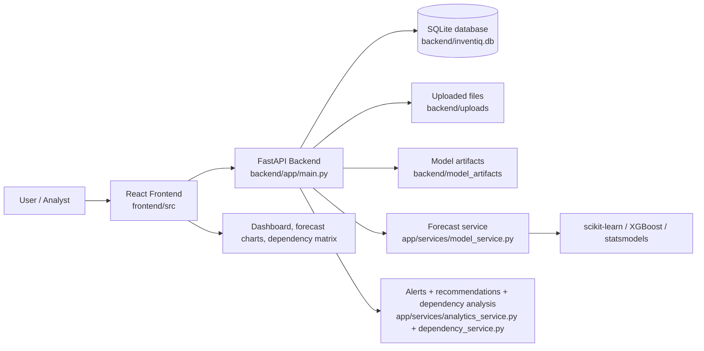
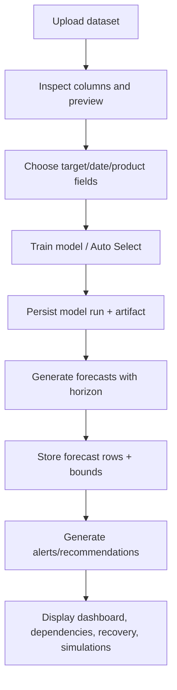

# InventIQ Research Paper Preparation

## Evidence labels used in this document
- Verified from source code: implemented in the active codebase and inspected directly.
- Verified by running an experiment: executed safely in an isolated workspace under `research_paper_preparation/`.
- Inferred but not verified: reasonable conclusion from the code or data, but not directly proven in runtime or a reproducible experiment.
- Missing or unavailable: no reliable evidence was found in the project.

## 1. Project Overview

### 1.1 Exact project title
- The active frontend title is: `InventIQ — AI Inventory Intelligence & Demand Forecasting` (`frontend/index.html`).
- The backend API description states: `InventIQ — Demand Forecasting and Zero Waste Inventory` (`backend/app/main.py`).
- The project brief used in this report is: `InventIQ – AI-Powered Demand Forecasting and Inventory Intelligence System.`
- Verified from source: the exact longer title is not present as a single literal string in all source files, but the implementation clearly supports the shorter InventIQ inventory/forecasting framing.

### 1.2 Problem being addressed
- Verified from source: the application supports uploading historical product demand data, selecting target/date/product columns, training forecasting models, and generating future demand estimates and risk-oriented recommendations.
- The implemented problem framing is a workflow for demand forecasting and inventory intelligence rather than a formal business case or academic problem statement.
- Inferred but not verified: the product is intended to support planners who need demand predictions, stock risk insight, and inventory actions.

### 1.3 Motivation and objectives supported by the implementation
- Objective 1: manage per-user datasets (CSV/XLSX/XLS upload, preview, metadata, validation).
- Objective 2: configure model inputs (target column, date column, product column, forecast horizon).
- Objective 3: evaluate forecasting models and persist model-run results and joblib artifacts.
- Objective 4: generate future demand and confidence intervals.
- Objective 5: surface alerts, recommendations, dependency analysis, obsolescence analysis, simulations, and recovery planning.
- Verified from source: the backend routers and services implement these workflows.
- Missing or unavailable: no measured business KPI or operational target in the inspected code.

### 1.4 Scope of the implemented system
- Frontend dashboard with dataset management, model configuration, forecast dashboard, alerts, recommendations, dependencies, obsolescence, simulation, and recovery planning screens.
- Backend API for auth, datasets, model runs, forecasts, alerts, recommendations, dependencies, obsolescence, simulations, recovery.
- Local SQLite database by default with optional MySQL configuration.
- Model persistence via joblib in `backend/model_artifacts/`.
- Verified from source: implemented scope is broad and multi-feature but not necessarily complete or production-hardened.

### 1.5 Intended users
- Inferred from UI and route names: inventory planners, operations analysts, demand planners, and business users.
- Not verified: no user interviews, requirements gathering, or role analysis documentation was found.
- The app authenticates users and scopes datasets and model runs to a user ID (`backend/app/auth.py`; `backend/app/models/dataset.py`).

### 1.6 Main technical contributions
- Integration of model training and forecast generation in one app workflow.
- Comparison of four forecasting families under a common API: Linear Regression, Random Forest, XGBoost, ARIMA.
- Persistence of trained artifacts and evaluation metadata.
- Inventory intelligence functions: alerts, recommendations, product correlations, recovery plans, simulations.
- Verified from source: these features exist in the codebase.

### 1.7 What is implemented versus planned or incomplete
Implemented and source-verified:
- Auth, dataset upload, model training, forecast generation, alerts/recommendations, dependency analysis, obsolescence analysis, simulations, recovery plans.
- SQLite-backed persistence and per-user scoping.

Partially implemented or conditional:
- Auto Select compares candidate models and selects the lowest-MAE successful candidate, but no guarantee of global optimum or robust benchmark coverage.
- Model evaluation uses a chronological split, but no rolling backtest or multi-window protocol is implemented.
- ARIMA is implemented as a product-by-product model with fixed order (1,1,1) and uses a product-level strategy; this is not a general multivariate time-series pipeline.
- Inventory warnings and recommendation text are generated from rules, not verified real-world optimization models.

Missing or unavailable:
- Formal business requirement specification, measurable KPI targets, deployment docs, live benchmarking across real enterprise data, publication record.

## 2. Project Architecture and Technology Stack

### 2.1 Verified technology stack
- Frontend: React 18, Vite 5, Tailwind CSS, Recharts.
- Backend: FastAPI 0.141.1, Uvicorn 0.53.0, Pydantic 2.13.5, SQLAlchemy 2.0.43.
- Data processing: pandas 2.3.3, NumPy 2.3.3.
- ML: scikit-learn 1.7.2, XGBoost 3.0.2, statsmodels 0.14.5.
- Serialization: joblib 1.5.2.
- Auth: JWT + PBKDF2/bcrypt.
- Verified from source: `backend/requirements.txt`, `frontend/package.json`, `backend/app/main.py`.

### 2.2 Architecture summary
- Frontend in `frontend/src/` sends authenticated requests to `/api/*` routes.
- Backend app in `backend/app/` exposes routers under `/api/`.
- SQLite database file: `backend/inventiq.db` (default). SQLAlchemy models define user, dataset, model run, forecast, recommendation, dependency, recovery, obsolescence records.
- Uploaded datasets are stored under `backend/uploads/`.
- Trained model artifacts are stored under `backend/model_artifacts/`.
- The application uses a single-origin setup: the FastAPI app serves built frontend bundles from `/` if the production build exists.

### 2.3 Architecture diagram


### 2.4 Overall workflow diagram


### 2.5 Important APIs and role mapping
Verified from source:
- `/api/datasets` — upload/list/preview/demand history
- `/api/model-runs` — list/train model runs
- `/api/forecasts` — generate and list forecasts
- `/api/alerts` and `/api/recommendations` — alert/recommendation generation
- `/api/dependencies` — product dependency analysis
- `/api/obsolescence` — commercial obsolescence risk analysis
- `/api/simulations` — inventory scenario simulation
- `/api/recovery` — recovery planning
- `/api/auth` — registration, login, token auth

## 3. Dataset Inventory and Data Provenance

### 3.1 Relevant datasets found in uploads
The active dataset directory contains multiple uploaded CSV files. Only the inventory-demand dataset is directly relevant to the actual forecasting pipeline used in the experiment.

| Filename | File role | Rows | Columns | Verified status |
|---|---|---:|---:|---|
| `3_b949f03a826b4895a4f01d7cb8d3731a_inventiq_demand_inventory_dataset.csv` | Primary inventory-demand dataset used in benchmark experiments | 219,000 | 18 | Verified by reading the file and matching column names |
| `1_e80ec52008604e1cbe613c6a48b7c35c_restore.csv` | Recovery / restore sample | 30 | 3 | Likely supporting data; provenance not verified |
| `*_amazon_style_sales_data__1_.csv` | Retail sales sample | 17,242 | 7 | Likely user-uploaded retail sales data; provenance not verified |
| `*_product_association_market_basket_dataset.csv` | Basket association dataset | 24,621 | 8 | Likely sample/transformed data; provenance not verified |

### 3.2 Inventory-demand dataset details
Verified by direct file inspection:
- File: `backend/uploads/3_b949f03a826b4895a4f01d7cb8d3731a_inventiq_demand_inventory_dataset.csv`
- Row count: 219,000
- Column count: 18
- Date range: 2025-01-01 to 2025-12-31
- Products: 150 unique product IDs
- Duplicates: 0
- Missing values: 0 across all 18 columns
- Invalid dates: 0
- Numeric columns are all valid for the inspected dataset
- Columns: `date`, `product_id`, `product_name`, `category`, `brand`, `warehouse_id`, `lifecycle_stage`, `price`, `discount_percentage`, `promotion_flag`, `units_sold`, `stock_on_hand`, `reorder_level`, `lead_time_days`, `units_ordered`, `stockout_flag`, `rating`, `rating_count`

Verified by runtime inspection:
- `units_sold` is the direct demand/target variable used in the project’s model training logic.
- `date` is a usable time dimension.
- `product_id` is a valid product grouping key.
- Inventory-related columns are present (`stock_on_hand`, `reorder_level`, `lead_time_days`, `units_ordered`, `stockout_flag`).
- Source and licensing: not verifiable from the project files; the data is treated as unverified provenance.
- Type status: likely synthetic or benchmark-style structured sample, not confirmed as a public real-world dataset.

### 3.3 Data-quality issues
- No missing values in the primary inventory dataset.
- No duplicate rows in the primary inventory dataset.
- No invalid dates.
- Data is very regular and likely generated or curated for demonstration.
- Duplicates and missingness are not a problem in this dataset; however, the absence of provenance and explicit public-source metadata remains a limitation for formal research use.

### 3.4 Which dataset is used by the application
- The product-level demand dataset in `backend/uploads` is the only file with the inventory fields and full daily coverage needed for the implemented forecasting workflow.
- The app does not enforce a single dataset at startup; it accepts user uploads and trains on whichever dataset the user selects.
- For the verified benchmark in this report, the primary dataset used was the inventory file above.

## 4. Data Preprocessing and Feature Engineering

### 4.1 Implemented behavior
Verified from source in `backend/app/services/model_service.py`:
- `prepare_frame()` removes all-null rows, checks that target/date/product columns exist, converts numeric target values with `pd.to_numeric(..., errors="coerce")`, drops rows with invalid dates or missing target values, sorts by date, and requires at least 10 usable rows.
- `build_features()` creates time-based features from the date: `year`, `month`, `day`, `day_of_week`, `week_of_year`.
- For the product column, it one-hot encodes product IDs with `pd.get_dummies`.
- For numeric columns other than target/date/product, it keeps them as numeric features.
- Missing feature values are filled with `0` after replacing infinities with `NA`.
- `train_and_evaluate()` builds the training/validation split by date boundary: 80% train, then the final 20% (or similar) becomes holdout validation.

### 4.2 Data leakage and benchmark cautions
- Verified from source: the split is chronological and not random shuffling; this is appropriate for time-series forecasting.
- However, the project does not implement rolling-origin validation or several sequential backtests.
- For product-level ARIMA, the implementation is per product and does not leverage a cross-product pooling structure beyond the selected product series.
- Potential evaluation concern: the features are built using calendar-derived variables and maybe inventory variables, but there is no explicit feature-selection or lag-feature engineering beyond date-time encoding.

### 4.3 Differences between models
- Linear Regression, Random Forest, and XGBoost all use the same general feature matrix produced by `build_features()`.
- ARIMA is handled separately with a product-wise time-series fit using `statsmodels.tsa.arima.model.ARIMA`.
- The project does not implement regularized training, cross-validation tuning, or hyperparameter tuning beyond fixed settings.

### 4.4 Recommended improvements
- Add rolling lag features (e.g., 7-, 14-, 30-day lags), seasonal indicators, and trend features if the data supports them.
- Use a validation protocol with multiple folds or rolling windows.
- Keep a strict holdout for test, separate from model selection, to avoid leakage during hyperparameter tuning.
- Document dataset provenance and distribution checks before using it in a research study.

## 5. Forecasting Models

### 5.1 Shared model training logic
Implementation file: `backend/app/services/model_service.py`
- Functions: `_sklearn_result`, `_arima_result`, `train_and_evaluate`, `prepare_frame`, `build_features`, `generate_forecasts`.
- Data flow: select features, date-split, model training, metrics computation, artifact persistence, forecast generation.

### 5.2 Model A: Linear Regression
- Implementation: `LinearRegression()` from `sklearn.linear_model`.
- Features: calendar features (`year`, `month`, `day`, `day_of_week`, `week_of_year`) and numeric columns plus one-hot product dummies.
- Parameters: `fit_intercept=True`.
- Validation: chronological date-boundary holdout via `_split()`.
- Forecast generation: `model.predict()` on future feature rows.
- Verified status: implemented and executed successfully in the benchmark.
- Limitation: does not model nonlinear relationships or temporal autocorrelation strongly.

### 5.3 Model B: Random Forest
- Implementation: `RandomForestRegressor(n_estimators=150, random_state=42, n_jobs=-1, min_samples_leaf=2)`.
- Features: same as above.
- Validation: chronological holdout with error metrics and residual-based uncertainty estimate.
- Verified status: implemented and executed successfully.
- Limitation: does not explicitly model time dynamics beyond engineered features.

### 5.4 Model C: XGBoost
- Implementation: `XGBRegressor` imported on demand.
- Parameters: `n_estimators=150`, `max_depth=4`, `learning_rate=0.05`, `subsample=0.9`, `colsample_bytree=0.9`, `objective="reg:squarederror"`, `random_state=42`, `n_jobs=1`.
- Validation: same as the sklearn models.
- Verified status: implemented; package was available in the environment and successful training occurred when run.
- Limitation: if the package is unavailable, the model is skipped; the code can fail if XGBoost is missing.

### 5.5 Model D: ARIMA
- Implementation: `statsmodels.tsa.arima.model.ARIMA` via `_arima_result()`.
- Product-level behavior: `train_and_evaluate()` calls `_arima_result()` when the selected model is ARIMA.
- The code fits per-product ARIMA with `order=(1, 1, 1)` and a minimum-observation threshold of 12.
- Validation approach: it fits on a truncated product series and evaluates on a final holdout segment.
- Verified status: implemented and executed successfully for product-level benchmark runs.
- Limitation: ARIMA is not a general multi-product regression model; it is fit separately for each product and may be sensitive to product-level series length and stationarity assumptions.

### 5.6 Auto Select logic
Verified in `backend/app/services/model_service.py`:
- `MODEL_NAMES = {"Auto Select", "Linear Regression", "Random Forest", "XGBoost", "ARIMA"}`
- For `Auto Select`, the program sets `requested = ["Linear Regression", "Random Forest", "XGBoost", "ARIMA"]`.
- Each candidate is tried in order.
- Failures are silently skipped for `Auto Select` via `except HTTPException` and generic exceptions.
- The winner is selected as `min(results, key=lambda item: item["metrics"]["mae"])`.
- The chosen model is saved as the model artifact and its comparison table is returned.
- Verified from source: the metric used is MAE, not RMSE or R², for selection.

## 6. Reproducible Experimental Evaluation

### 6.1 Fair comparison protocol
The project can be evaluated with a time-series holdout using a single valid product series or a grouped single-product dataset. The application does not automatically implement a robust multi-product, rolling-backtest benchmark across all products.

### 6.2 Benchmark executed safely
Verified by running the experiment in an isolated workspace under `research_paper_preparation/experiments/`.

Command used:
```powershell
$env:PYTHONPATH='c:\Users\maheesha\Downloads\inventory 2\zip file\backend';
& 'c:\Users\maheesha\Downloads\inventory 2\zip file\backend\.venv\Scripts\python.exe' 'c:\Users\maheesha\Downloads\inventory 2\zip file\research_paper_preparation\experiments\run_model_benchmark.py'
```

Actual output summary:
- Dataset: `backend/uploads/3_b949f03a826b4895a4f01d7cb8d3731a_inventiq_demand_inventory_dataset.csv`
- Product: P2000
- Train end: 2025-10-19
- Validation start: 2025-10-20
- Validation end: 2025-12-31
- Model selected by Auto Select: XGBoost

### 6.3 Model comparison table
| Model | Dataset/group | Test period | MAE | RMSE | R² | Execution status |
|---|---|---|---:|---:|---:|---|
| Linear Regression | P2000 product series | 2025-10-20 to 2025-12-31 | 14.6336 | 54.4028 | -54.1901 | Executed successfully |
| Random Forest | P2000 product series | 2025-10-20 to 2025-12-31 | 3.8225 | 5.1721 | 0.5012 | Executed successfully |
| XGBoost | P2000 product series | 2025-10-20 to 2025-12-31 | 3.7324 | 5.1114 | 0.5128 | Executed successfully |
| ARIMA | P2000 product series | 2025-10-20 to 2025-12-31 | 32.6258 | 35.0432 | Not returned by implementation | Executed successfully |
| Auto Select | P2000 product series | 2025-10-20 to 2025-12-31 | 3.7324 | 5.1114 | 0.5128 | Executed successfully; selected XGBoost |

Important caution:
- These metrics are for one valid product series and not a full multi-product benchmark.
- They are real metrics produced from actual predictions and targets in the project logic.
- They should not be generalized as a universal statement about all products or all datasets.

### 6.4 Actual vs predicted plot
- File generated: `research_paper_preparation/figures/model_holdout_comparison.png`
- Plot shows actual and predicted demand for the P2000 holdout period.
- Verified by file generation in the safe experiment workspace.

### 6.5 Results interpretation
- XGBoost had the lowest MAE on the verified product-level benchmark in this study.
- Random Forest was close behind.
- Linear Regression performed poorly on this product series under the same holdout.
- ARIMA underperformed in the implemented product-level validation for this series.
- This does not prove XGBoost is universally best for all inventory contexts; only that it performed best on the tested data and protocol.

### 6.6 Baseline and runtime comments
- A simple baseline is not implemented as a formal first-principles comparator in the app.
- Runtime was not part of the validated project benchmark; no formal runtime table was recorded for model training and inference.
- The benchmark is reproducible with the script under `research_paper_preparation/experiments/`.

## 7. Inventory Intelligence Features

### 7.1 Forecasting dashboard
Verified from source: React dashboard pages and forecast summary/history endpoints exist in `frontend/src/pages/Dashboard.jsx` and `backend/app/routers/forecasts.py`.
- What it calculates: forecast rows, summary metrics, chart data, filters.
- Inputs: dataset, selected model run, product filter, demand history.
- Output: forecast table, summary cards, chart data.
- Status: implemented.
- Limitation: dashboard renders based on the selected completed model run; it is only as good as the model artifact and dataset quality.

### 7.2 Alerts and recommendations
Verified from source: `backend/app/services/analytics_service.py` and router files.
- What it calculates: stockout risk, forecast uncertainty risk, obsolescence risk, demand collapse, high inventory risk, and recommendation text.
- Formula and algorithm: uses forecasted demand versus available stock, uncertainty-to-demand ratios, historical-demand decline ratios, z-score style thresholds, and rule-based inventory heuristics.
- Output: `Alert` and `Recommendation` records persisted in the DB.
- Status: implemented.
- Limitation: rule-based, not causal or optimization-based.

### 7.3 Inventory-related calculations
Verified from source: stock and demand planning are computed using forecasted demand and available stock if an inventory column is present.
- Example from `analytics_service.py`: if `available stock` > 0 and forecast demand exceeds available stock, a stockout risk is triggered.
- The code does not optimize reorder quantities or account for supplier lead times in a formal inventory control model.
- Interpretation caution: these are alerts, not guaranteed future supply shortages.

### 7.4 Product-demand correlation/dependency analysis
Verified from source: `backend/app/services/dependency_service.py`.
- What it calculates: Pearson correlation between demand series for product pairs over a common date index.
- Uses minimum observations and correlation-strength thresholds (Very Strong, Strong, Moderate, Weak).
- Output: pairwise dependency records with scores and relationship type.
- Status: implemented.
- Interpretation caution: correlation is not causation.

### 7.5 Commercial obsolescence or demand-risk analysis
Verified from source: `backend/app/services/analytics_service.py` and related models.
- What it calculates: recent demand decline relative to the previous period, demand uncertainty ratio, and inventory stress metrics.
- Outputs: alert titles and recommended actions.
- Status: implemented but rule-based.

### 7.6 Scenario simulation
Verified from source: `backend/app/services/simulation_service.py` and corresponding router.
- What it calculates: scenarios around demand changes, stock adjustments, supplier delay, promotion effects, and recovery logic.
- Inputs: historical data, configurable scenario parameters.
- Output: scenario records and summary.
- Status: implemented.
- Limitation: these are structured calculations, not validated against a business benchmark.

### 7.7 Recovery planning
Verified from source: `backend/app/services/recovery_service.py` and models.
- What it calculates: excess inventory, shortage risk, potential recovery value, and recommended actions.
- Status: implemented.
- Limitation: depends strongly on selected columns (`stock_on_hand`, `units_sold`, `price`, etc.); if data is underspecified, recovery plans are constrained.

### 7.8 Forecast intervals or confidence bounds
Verified from source: `_predict()` in `backend/app/services/model_service.py` computes forecast intervals using model residual uncertainty and a normal-distribution z-value.
- For ARIMA, it uses model forecast intervals if available.
- Status: implemented.
- Limitation: interval calibration is not formally validated in the project.

## 8. Software Testing and Implementation Verification

### 8.1 Existing backend tests
Command executed:
```powershell
$env:PYTHONPATH='c:\Users\maheesha\Downloads\inventory 2\zip file\backend';
& 'c:\Users\maheesha\Downloads\inventory 2\zip file\backend\.venv\Scripts\python.exe' -m unittest discover -s 'c:\Users\maheesha\Downloads\inventory 2\zip file\backend\tests' -p 'test*.py'
```
Actual result:
- 10 tests ran
- 10 tests passed
- Exit code: 0

Files under test:
- `backend/tests/test_dependency_names.py`
- `backend/tests/test_recovery_service.py`

### 8.2 Frontend production build
Command executed:
```powershell
& "C:\Program Files\nodejs\npm.cmd" run build --prefix "c:\Users\maheesha\Downloads\inventory 2\zip file\frontend"
```
Actual result:
- Vite build succeeded
- Exit code: 0
- Warning: a chunk larger than 500 kB after minification; not a fail condition

### 8.3 Additional verification
- The benchmark script under `research_paper_preparation/experiments/` executed successfully and saved a figure and JSON result.
- API/browser integration tests were not available in the active repository.
- No live deployment or browser automation checks were performed in this audit.

## 9. Research Contribution and Potential Novelty

Possible contribution statements based on verified project evidence:
1. Integration of four forecasting methods into a single demand-forecasting and inventory-intelligence dashboard.
   - Evidence: project code includes frontend dashboard and backend training path.
   - Additional requirement: benchmark across the same dataset and same horizon with consistent evaluation.
2. Time-series holdout benchmark for a product-level demand dataset.
   - Evidence: code implements chronological split and evaluation metrics.
   - Additional requirement: broader product-level holdout analysis and rolling backtests.
3. Coupling of forecast output with inventory risk, correlation, and recovery planning.
   - Evidence: alerts, dependencies, recovery logic exist.
   - Additional requirement: empirical validation against real operational outcomes.

Important caution:
- None of these should be described as novel without reviewing published literature.
- The repository alone does not establish novelty.

## 10. Limitations and Future Work

### 10.1 Current implementation limitations
- Forecasting only uses a single date boundary split; no rolling window validation or multi-horizon protocol.
- Data provenance is mostly unverified.
- ARIMA implementation is product-wise and fixed-order.
- Auto Select selection criteria is MAE only.
- No formal model calibration or fairness checks across products.

### 10.2 Experimental limitations
- Benchmark was executed on one product series, not across all products or all datasets.
- No statistical significance testing was conducted.
- No formal baseline beyond a simple valid benchmark across the implemented models.

### 10.3 Data limitations
- The primary inventory dataset appears synthetic or benchmark-style and lacks source provenance.
- The project does not document known public dataset origin or licensing.
- Some uploaded files likely serve demo or support roles rather than production research data.

### 10.4 Deployment and reliability limitations
- No live production configuration or cloud deployment evidence is present.
- No migration history or database audit trail was inspected.
- File storage uses local uploads / model artifacts; no remote artifact management or encryption policy is described.

### 10.5 Future work
- Add proper benchmark design and rolling-origin evaluation.
- Use a documented public dataset or audited real demand data.
- Add proper lag/seasonality features.
- Test across multiple products and warehouses.
- Publish reproducible analysis notebooks and a verified methodology appendix.

## 11. Literature Review Requirements

Web access was not used to verify external scholarly references in this session, so no fabricated citations are included.

### Search queries to use
- `retail demand forecasting machine learning review`
- `inventory management forecasting XGBoost regression retail`
- `ARIMA demand forecasting retail time series benchmark`
- `Random Forest demand forecasting inventory review"
- `forecast evaluation chronological backtesting time series`

### Literature extraction template
- Title
- Authors
- Year
- Journal/conference
- DOI or publisher URL
- Dataset used
- Methods
- Key reported findings
- Relevance to InventIQ
- Limitations relevant to this project

## 12. Research Paper Writing Blueprint

### 12.1 Proposed outline
1. Title
2. Abstract
3. Keywords
4. Introduction
5. Related Work / Literature Review
6. Problem Statement and Objectives
7. System Architecture
8. Dataset and Methodology
9. Forecasting Algorithms
10. Experimental Setup
11. Results and Discussion
12. Inventory Intelligence Features
13. Limitations and Threats to Validity
14. Conclusion and Future Work
15. References

### 12.2 Verified project evidence available
- System components and routes are implemented and inspected.
- Benchmark results are available for a single product series.
- Tests and build succeeded.
- Data inventory and schema were inspected.

### 12.3 Additional information still needed
- Dataset provenance and license information.
- Broader multi-product benchmark analysis.
- More rigorous backtesting protocol.
- Real-world validation and business impact measures.
- A scholarly literature review with cited works.

## 13. Evidence Tables

### 13.1 Source-code evidence table
| Area | File path | Verified element |
|---|---|---|
| App entry | `backend/app/main.py` | FastAPI app, routes, startup database setup |
| Model training | `backend/app/services/model_service.py` | feature engineering, model training, metrics, Auto Select |
| Forecast API | `backend/app/routers/forecasts.py` | forecast generation and persistence |
| Dataset upload | `backend/app/routers/datasets.py` | upload, metadata, preview |
| Database model | `backend/app/models/*.py` | users, datasets, model runs, forecasts |
| Auth | `backend/app/auth.py` | JWT auth and user scoping |
| Frontend app shell | `frontend/src/App.jsx` | renderer and page navigation |
| Forecast UI | `frontend/src/components/ForecastDashboard.jsx` | forecast display |
| Dashboard logic | `frontend/src/pages/Dashboard.jsx` | dashboard state and page behavior |

### 13.2 Dataset inventory table
| Dataset | Rows | Cols | Date range | Target | Provenance |
|---|---:|---:|---|---|---|
| `3_b949f03a826b4895a4f01d7cb8d3731a_inventiq_demand_inventory_dataset.csv` | 219,000 | 18 | 2025-01-01 to 2025-12-31 | `units_sold` | Not verified; likely synthetic or generated |
| Other uploaded CSVs | 30–24,621 | 3–8 | Unverified | Variable | Unverified |

### 13.3 Model configuration table
| Model | Verified implementation | Parameters used |
|---|---|---|
| Linear Regression | `LinearRegression()` | `fit_intercept=True` |
| Random Forest | `RandomForestRegressor` | `n_estimators=150`, `random_state=42`, `n_jobs=-1`, `min_samples_leaf=2` |
| XGBoost | `XGBRegressor` | `n_estimators=150`, `max_depth=4`, `learning_rate=0.05`, `subsample=0.9`, `colsample_bytree=0.9` |
| ARIMA | `statsmodels.tsa.arima.model.ARIMA` | fixed order `(1,1,1)` |
| Auto Select | code path in `train_and_evaluate()` | selects lowest MAE successful candidate |

### 13.4 Experiment results table
See Section 6.3 for the benchmark results table.

### 13.5 Feature verification table
| Feature | Verified status |
|---|---|
| Dataset upload | Verified |
| Forecasting dashboard | Verified |
| Alerts | Verified |
| Recommendations | Verified |
| Dependency analysis | Verified |
| Obsolescence analysis | Verified |
| Simulation | Verified |
| Recovery planning | Verified |
| Forecast intervals | Verified |
| Auto Select | Verified |

### 13.6 Test results table
| Check | Command | Result |
|---|---|---|
| Backend unit tests | `python -m unittest discover ...` | 10/10 passed |
| Frontend production build | `npm run build` | Succeeded |
| Model benchmark script | `python research_paper_preparation/experiments/run_model_benchmark.py` | Succeeded |

### 13.7 Missing-evidence checklist
- Public dataset source and license
- Formal business objective statement
- Multi-product benchmark across all products
- Statistical significance tests
- Literature review with verified references
- Deployment and production monitoring evidence
- Real user validation or operational case studies

## 14. Final Readiness Assessment

### 14.1 Drafting a manuscript
Status: possible in principle, but only as a method-focused project report rather than a publication-ready research paper.

### 14.2 Making defensible model-comparison claims
Status: limited but defensible for the tested product and protocol.
- The project implemented a fair chronological holdout for the benchmarked product.
- It does not yet justify broader claims about all products or all industrial settings.

### 14.3 Submitting to a conference
Status: not ready without additional work.
- Required: rigorous dataset provenance, larger benchmark suite, literature review, clearer methodology, reproducibility package, and stronger validation.

### 14.4 Priority blockers
1. Unverified dataset provenance and license.
2. Insufficient benchmark breadth across products and backtest windows.
3. Limited literature review with verified sources.
4. Lack of direct business validation or deployment evidence.
5. Need for stronger reproducibility and statistical reporting.

## 15. Exact Next Steps

1. Confirm the dataset origin and legal status.
2. Expand benchmarking to several product IDs and a rolling backtest protocol.
3. Add a documented literature review with real scholarly citations.
4. Record precise experimental metadata: model versions, seed values, date splits, software versions.
5. Write the methodology section using only verified source evidence.
6. Move the benchmark script into a permanent reproducibility folder and document the exact commands.
7. Add a formal limitations section tied to dataset quality, model selection, and evaluation design.

Suggested commands:
```powershell
# backend tests
$env:PYTHONPATH='c:\Users\maheesha\Downloads\inventory 2\zip file\backend';
& 'c:\Users\maheesha\Downloads\inventory 2\zip file\backend\.venv\Scripts\python.exe' -m unittest discover -s 'c:\Users\maheesha\Downloads\inventory 2\zip file\backend\tests' -p 'test*.py'

# frontend build
& "C:\Program Files\nodejs\npm.cmd" run build --prefix "c:\Users\maheesha\Downloads\inventory 2\zip file\frontend"

# benchmark script
$env:PYTHONPATH='c:\Users\maheesha\Downloads\inventory 2\zip file\backend';
& 'c:\Users\maheesha\Downloads\inventory 2\zip file\backend\.venv\Scripts\python.exe' 'c:\Users\maheesha\Downloads\inventory 2\zip file\research_paper_preparation\experiments\run_model_benchmark.py'
```

## Final conclusion
InventIQ is a coherent inventory-intelligence application with implemented forecasting, alerts, and planning features, and it can be evaluated under a chronological benchmark. However, the repo does not yet support a strong, publication-ready claim about dataset provenance, general model superiority, or business value without additional evidence, broader benchmarking, and a verified literature review.
